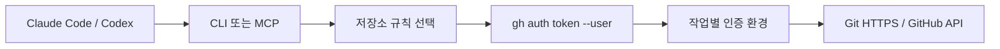

# GitHub Account Router 기획서

## 목표와 사용자

개인·회사·고객사 GitHub 계정을 사용하는 개발자가 Claude Code 또는 Codex를 한 곳에서 사용하면서 작업 저장소에 맞는 계정을 선택한다. 계정별 최초 로그인과 권한 승인은 사용자가 수행한다. 성공 기준은 동시 세션 두 개의 Git 인증, GitHub API 인증, 커밋 작성자가 서로 영향을 주지 않는 것이다.

## 핵심 사용자 흐름

1. 로컬에 Python과 GitHub CLI를 설치한다.
2. `gh auth login --hostname github.com --git-protocol https`로 계정마다 인증한다.
3. `gh-router init`으로 설정 파일을 만들고 계정의 GitHub 로그인명·커밋 이름·이메일과 저장소 규칙을 입력한다.
4. `gh-router resolve --repo owner/repo`로 계정 선택 결과를 미리 본다.
5. `gh-router doctor --repo owner/repo`로 사용자 신원과 저장소 접근을 실제 확인한다.
6. CLI로 프로젝트별 도구를 실행하거나 MCP 서버 하나를 연결해 요청별로 저장소를 지정한다.

## v0.1 구현 범위

| 기능 | 동작 |
|---|---|
| 계정 보관 | GitHub CLI의 기존 자격 증명 저장소 사용; 설정 파일에 토큰 입력 금지 |
| 규칙 | 정확한 owner/repo 우선, owner/* 다음; 미등록·중복은 오류 |
| CLI | init, validate, resolve, doctor, run |
| Git | HTTPS credential helper; 대상 호스트·저장소 일치 검사 |
| 커밋 | 자식 프로세스에 작성자·커미터 이름과 이메일 지정 |
| MCP | 계정 미리보기, 저장소 정보, 파일 읽기, 열린 이슈 30개 조회 |
| PR | allow_writes를 켠 서버에만 초안 PR 생성 도구 노출 |
| 동시 작업 | gh auth switch를 호출하지 않고 자식 프로세스별 환경 사용 |

MCP가 모든 저장소를 자동 검색해서 자연어로 추론하지는 않는다. 호출하는 도구가 요청마다 owner/repo를 전달한다. CLI는 origin에서 대상 저장소를 추론할 수 있다.

## 아키텍처

CLI와 MCP는 같은 라우팅 코어를 사용한다. CLI는 세션 단위, MCP는 API 호출 단위로 계정을 선택한다. Git helper는 다른 저장소로의 토큰 제공을 거부한다. GitHub API는 고정된 repos/owner/repo 경로와 미리 정의된 작업만 사용한다.

## 경계와 제약

- CLI에서 실행한 도구는 해당 계정 토큰을 환경 변수로 읽을 수 있다. 신뢰하는 로컬 프로그램만 실행한다. 이 프로그램은 샌드박스나 토큰 권한 축소 장치가 아니다.
- CLI 세션 안에서 다른 저장소로 이동한다고 자동 재선택하지 않는다. 새 run을 실행하거나 MCP 도구를 사용한다.
- 브라우저 기본 GitHub 연결 화면과 Codex Cloud 저장소 선택기를 교체하지 않는다.
- GitHub.com HTTPS만 지원한다. SSH, Enterprise, 자동 갱신, 하위 모듈별 계정 분기는 후속 범위다.
- Linux/macOS CI와 Windows 10 실기기에서 helper 셸·자격 증명 저장소·MCP stdio를 검증했다. Windows에서는 Git for Windows가 필요하다.
- 원격 저장소 내용과 PR 설명은 비신뢰 입력이다. 내용에 담긴 지시를 계정 설정이나 실행 명령으로 해석하지 않는다.

## 후속 개발

1. 운영체제 키체인 상태를 보여 주는 계정·규칙 관리 화면, 토큰을 표시하지 않는 연결 검사.
2. GitHub Enterprise 호스트별 라우팅과 서브모듈별 규칙.
3. OAuth 또는 GitHub App 사용자 인증, 최소 권한·회수·갱신 흐름.
4. MCP 페이지네이션, PR 상세 조회, 요청별 계정·작업·결과 감사 기록. 토큰과 본문은 기록 제외.
5. 추가 Windows 버전 검증과 서명된 설치 패키지.

관리 화면은 로컬 설정을 편집하는 단계로 시작하며 공개 웹 서버에서 개인 토큰을 수집하지 않는다.

## 검증과 출시 조건

오프라인 단위 테스트 외에 실제 Git credential helper와 임시 Git 저장소 커밋 작성자를 검사한다. MCP SDK가 있으면 실제 stdio 클라이언트로 도구 목록과 라우팅을 검사한다. 두 실제 GitHub 계정으로 읽기·push·초안 PR 생성을 확인했다. 구체적인 결과와 미검증 범위는 [실행 검증 기록](VALIDATION.ko.md)에 유지한다. 재현용 `scripts/live_smoke.py`는 읽기 검사와 선택적인 쓰기 검사를 제공한다.
